<p align="center">
  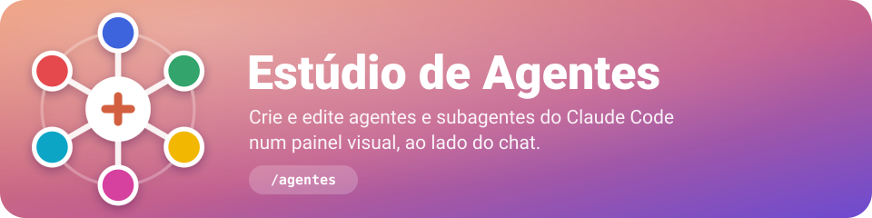
</p>

<p align="center">
  
  
  
</p>

Plugin que cria e edita **agentes e subagentes do Claude Code** de forma visual, num painel ao lado
do chat. Nada de editar YAML na mão: você vê a galeria dos seus agentes, abre um no editor, liga e
desliga ferramentas com um clique, escolhe modelo e cor, escreve o prompt com pré-visualização e
salva. O arquivo `.md` gerado é exatamente o formato que o Claude Code lê.

## Instalação

O estúdio depende de 7 plugins de 4 marketplaces (histórico, revisão de edições, sala do squad e
popup de perguntas). Adicione os 4 marketplaces antes; ao instalar o agents-creator, o Claude Code
instala os 7 junto.

| Plugin | Marketplace | Para quê |
|---|---|---|
| `historico`, `historico-painel` | `historico-requisicoes` (`marco3079/skill-git-claude-code`) | checkpoint git a cada pedido, com o painel do histórico |
| `diff-review`, `diff-review-pane` | `skill-diff-claude-code` (`marco3079/skill-diff-claude-code`) | revisar, manter ou desfazer as edições, com diff no painel |
| `squad-stream`, `squad-room-pane` | `skill-squad-room` (`marco3079/skill-squad-room`) | a sala onde os agentes do squad conversam, com painel ao vivo |
| `popup-perguntas` | `popup-perguntas` (`marco3079/skill-popup-duvida-cloude-code`) | perguntas ao usuário num popup, com texto, imagem e arquivo |

### Instalar ou atualizar tudo de uma vez

No Git Bash (Windows), no macOS ou no Linux:

```bash
if [ -d "$HOME/.claude-agents-creator/repo/.git" ]; then
  git -C "$HOME/.claude-agents-creator/repo" pull
else
  git clone https://github.com/marco3079/plugin-agents-creator-claude-code.git "$HOME/.claude-agents-creator/repo"
fi
node "$HOME/.claude-agents-creator/repo/install.js"
```

No PowerShell do Windows:

```powershell
$repo = "$env:USERPROFILE\.claude-agents-creator\repo"
if (Test-Path "$repo\.git") { git -C $repo pull } else { git clone https://github.com/marco3079/plugin-agents-creator-claude-code.git $repo }
node "$repo\install.js"
```

O instalador faz o seguinte:

- registra os marketplaces que faltam e instala ou atualiza o estúdio e os 7 plugins;
- atualiza o catálogo dos marketplaces que vêm do GitHub;
- ativa os plugins que estiverem desativados;
- instala o que esses plugins declaram como dependência;
- copia as skills squad-stream e review-edits para `~/.claude/skills` (o /sala e o /revisao procuram lá);
- instala ou atualiza as extensões do VS Code de cada plugin, quando o comando `code` está no PATH;
- confere Node.js 18+, git e o VS Code;
- confere se o servidor do popup conecta.

O que já está na versão mais nova, ou vem de uma pasta local, fica como está. Rode antes com `--simular`
para ver o que ele faria.

Para ver a situação sem alterar nada, rode:

```bash
node "$HOME/.claude-agents-creator/repo/install.js" --verificar
```

Para também instalar o Node.js, o git ou o VS Code que faltarem (winget no Windows, brew no macOS), rode:

```bash
node "$HOME/.claude-agents-creator/repo/install.js" --programas
```

Também dá para pedir ao Claude:
*instala https://github.com/marco3079/plugin-agents-creator-claude-code*. Ele segue o
[INSTALL.md](INSTALL.md).

### No app desktop do Claude (aba Code)

O comando `/plugin` não funciona no app desktop. Lá a instalação é pelo menu:

1. Clique em **+** ao lado da caixa de mensagem e escolha **Plugins**.
2. Em **Add marketplace**, adicione um por vez estes 5 marketplaces: `marco3079/skill-git-claude-code`,
   `marco3079/skill-diff-claude-code`, `marco3079/skill-squad-room`,
   `marco3079/skill-popup-duvida-cloude-code` e `marco3079/plugin-agents-creator-claude-code`.
3. Clique em **Add plugin** e escolha **agents-creator**.
4. Digite `/agentes`. Se o comando não aparecer, abra uma sessão nova.

### No terminal

Dentro do Claude Code:

```
/plugin marketplace add marco3079/skill-git-claude-code
/plugin marketplace add marco3079/skill-diff-claude-code
/plugin marketplace add marco3079/skill-squad-room
/plugin marketplace add marco3079/skill-popup-duvida-cloude-code
/plugin install agents-creator --marketplace marco3079/plugin-agents-creator-claude-code
```

Responda `y` para adicionar o marketplace e escolha o escopo (usuário é o padrão). Ou direto pelo
shell:

```bash
claude plugin marketplace add marco3079/skill-git-claude-code
claude plugin marketplace add marco3079/skill-diff-claude-code
claude plugin marketplace add marco3079/skill-squad-room
claude plugin marketplace add marco3079/skill-popup-duvida-cloude-code
claude plugin install agents-creator --marketplace marco3079/plugin-agents-creator-claude-code
```

Instalado pelo terminal no escopo de usuário, o plugin também carrega nas sessões do app desktop.

Depois de instalar e de rodar `/reload-plugins` (ou abrir uma sessão nova), rode `/agentes-dependencias`: ela confere e corrige as skills do /sala e do /revisao, as extensões do VS Code e os programas, e confere se o servidor do popup está rodando.

Precisa de um Claude Code recente, com suporte a plugins de *function hooks* (os painéis ao lado do
chat); foi testado no 2.1.312.

<details>
<summary><b>Problemas na instalação</b></summary>

- **`/plugin` não está disponível**: você está no app desktop; use o menu **+ → Plugins** acima ou
  instale pelo terminal.
- **A opção `--marketplace` não é reconhecida**: o Claude Code está desatualizado. Atualize com
  `claude update` (ou atualize o app). Em versões antigas, estes dois passos instalam, mas o painel
  só funciona numa versão recente:
  ```
  /plugin marketplace add marco3079/plugin-agents-creator-claude-code
  /plugin install agents-creator@agents-creator
  ```
- **Já existe um marketplace `agents-creator`** (por exemplo, a pasta local adicionada antes):
  `/plugin marketplace remove agents-creator` e instale de novo.
- **Erro de SSH ao clonar** ("Permission denied (publickey)"): adicione pelo endereço HTTPS,
  `/plugin marketplace add https://github.com/marco3079/plugin-agents-creator-claude-code.git`.
- **"Filename too long" no Windows**: rode `git config --global core.longpaths true` e tente de novo.
- **`Dependency "…" is not installed`** (o estúdio fica desligado): adicione o marketplace que falta com
  `/plugin marketplace add marco3079/<repo>` (a tabela no início desta seção diz qual é o repositório) e
  rode `/reload-plugins`; o Claude Code instala as dependências que faltam. Isso também acontece ao
  atualizar da 0.1.0, porque `claude plugin update` não instala as dependências novas: rode o
  instalador (`node install.js`, veja [Instalar ou atualizar tudo de uma vez](#instalar-ou-atualizar-tudo-de-uma-vez)),
  que instala de uma vez as que faltam.
- **Ao atualizar da 0.3.0 para a 0.4.0**: rode o instalador de novo (`node install.js`, veja [Instalar ou atualizar tudo de uma vez](#instalar-ou-atualizar-tudo-de-uma-vez)) para copiar as skills e instalar as extensões do VS Code. Depois, rode `/reload-plugins` e use `/agentes-dependencias` para conferir.
- **Instalou, mas `/agentes` não aparece**: abra uma sessão nova (no terminal, `/reload-plugins`) e
  confira se o Claude Code está atualizado.

</details>

<details>
<summary><b>A partir de uma cópia local (para desenvolver)</b></summary>

```bash
claude plugin marketplace add "D:\caminho\para\plugin-agents-creator-claude-code"
```

```bash
claude plugin install agents-creator@agents-creator
```

Um marketplace de pasta é lido da própria pasta: depois de editar os arquivos, rode
`/reload-plugins`. Para uma sessão só, sem instalar: `claude --plugin-dir <pasta>`.

</details>

## Telas

<table>
  <tr>
    <td width="50%" valign="top"><b>Galeria</b><br>Agentes do projeto, do usuário e de plugins; quem está rodando agora e quantas vezes cada um foi usado.<br><br>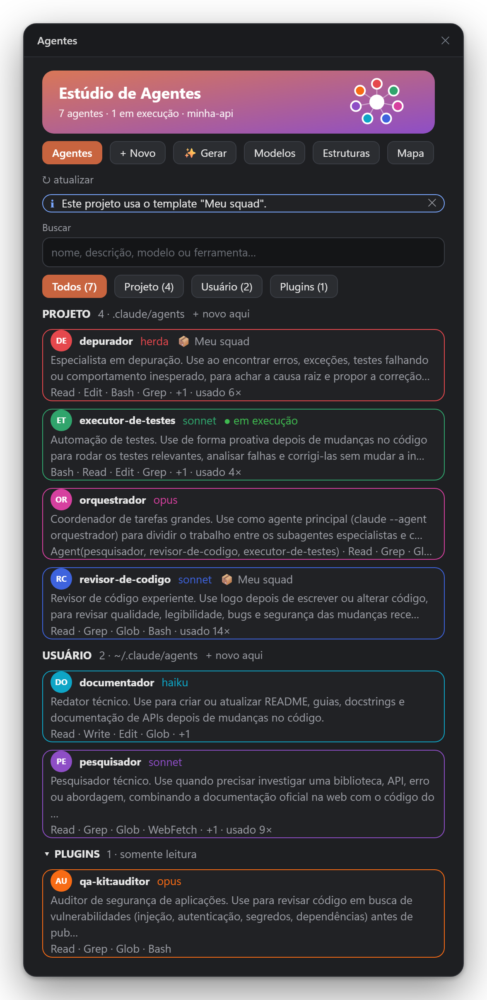</td>
    <td width="50%" valign="top"><b>Editor</b><br>Prévia do agente, identidade, cor e ferramentas por categoria, com validação ao vivo.<br><br>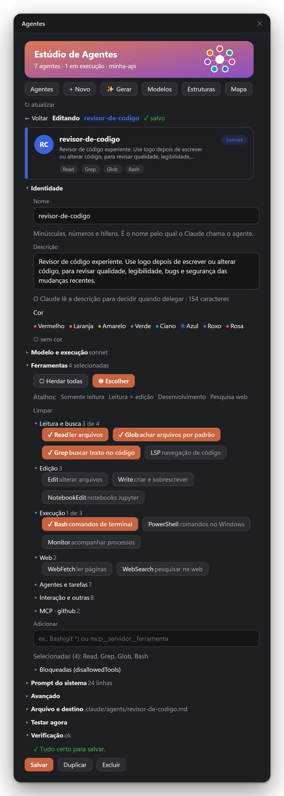</td>
  </tr>
  <tr>
    <td width="50%" valign="top"><b>Mapa de delegação</b><br>Quem é o agente principal e para quem ele delega; ⤷ marca os orquestradores.<br><br>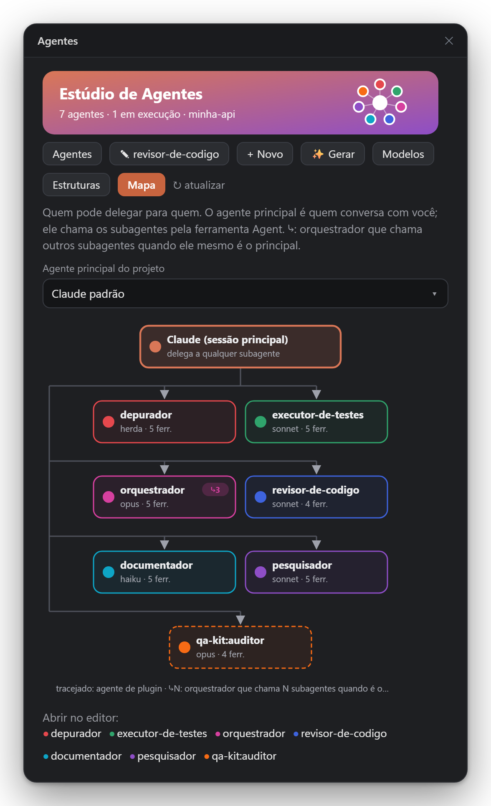</td>
    <td width="50%" valign="top"><b>Gerar com IA</b><br>Descreva o agente numa frase e revise o rascunho que o Claude escreve.<br><br>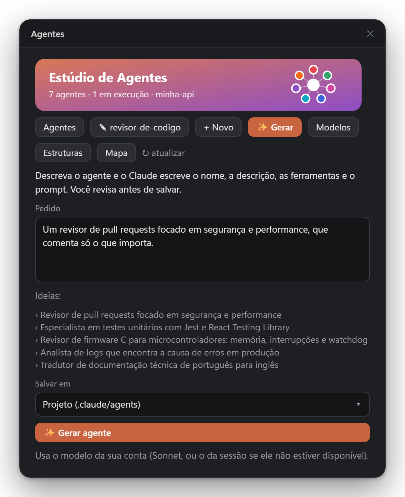</td>
  </tr>
  <tr>
    <td width="50%" valign="top"><b>Estruturas</b><br>Dez equipes prontas para baixar no projeto, com os plugins de que elas dependem.<br><br>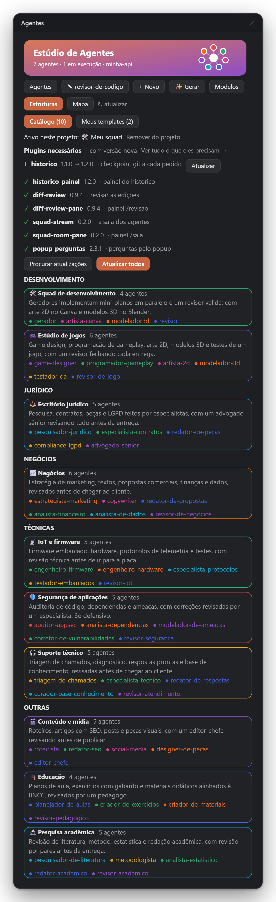</td>
    <td width="50%" valign="top"><b>Estrutura aberta</b><br>A equipe, os requisitos e o fluxo do agente principal antes de baixar.<br><br>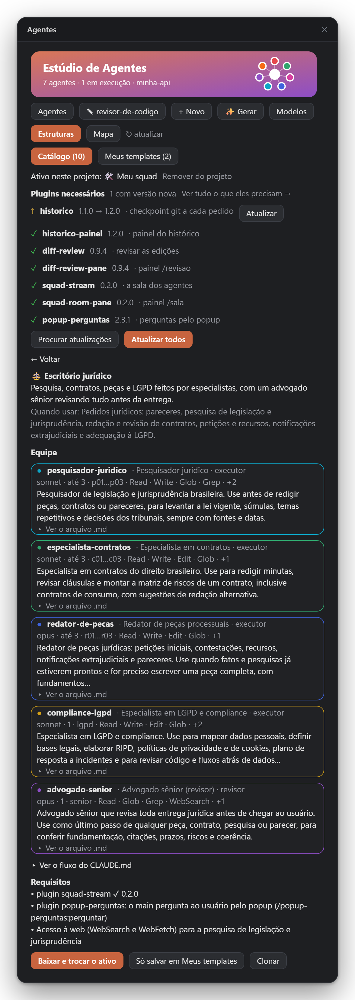</td>
  </tr>
  <tr>
    <td width="50%" valign="top"><b>Meus templates</b><br>Os templates salvos neste usuário: Editar nos seus; nas cópias do catálogo, Clonar para editar, e Atualizar quando o catálogo tem versão nova.<br><br>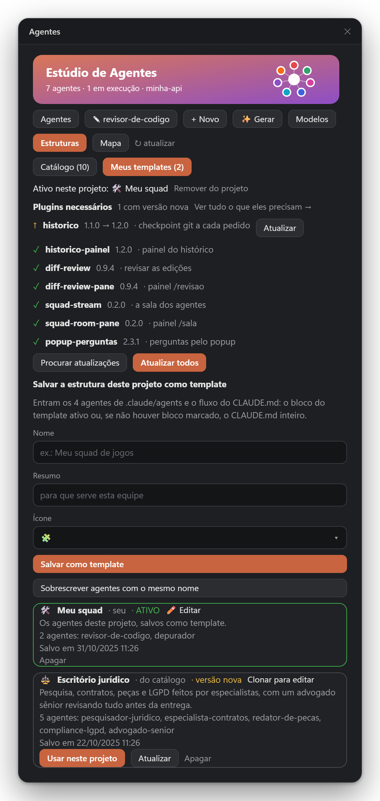</td>
    <td width="50%" valign="top"><b>Template aberto</b><br>Edite um template seu na própria aba: nome, resumo, ícone, fluxo do CLAUDE.md e os agentes. Salvar atualiza só o template; o projeto muda quando você aplica o template.<br><br>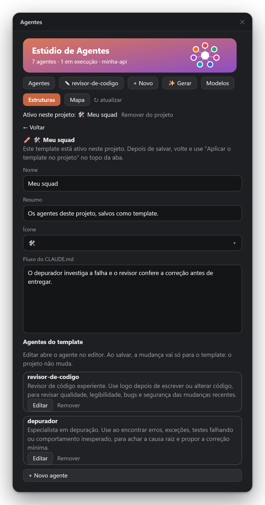</td>
  </tr>
  <tr>
    <td colspan="2" valign="top"><b>Dependências</b><br>Os plugins do estúdio e o que cada um precisa (skills, extensões do VS Code, programas e o servidor do popup), com Verificar tudo, Corrigir tudo e o botão de cada item.<br><br>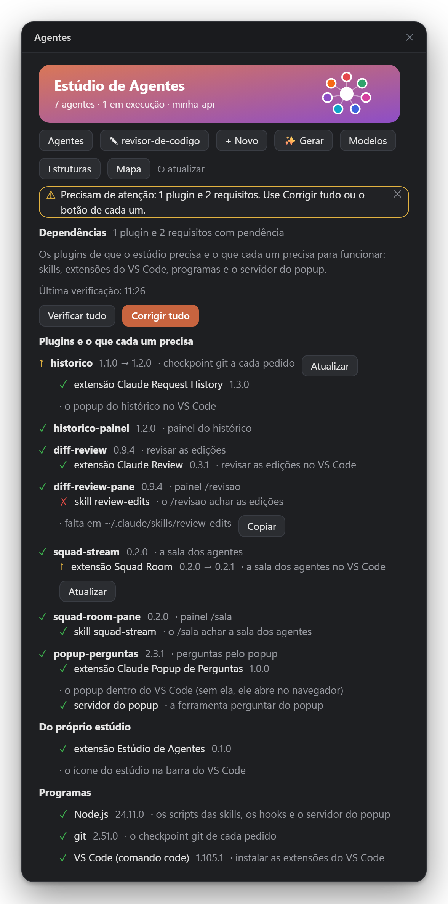</td>
  </tr>
</table>

<details>
<summary><b>Mais telas: prompt, modelos prontos e terminal</b></summary>
<br>
<table>
  <tr>
    <td width="50%" valign="top"><b>Modelo e prompt do sistema</b><br><br>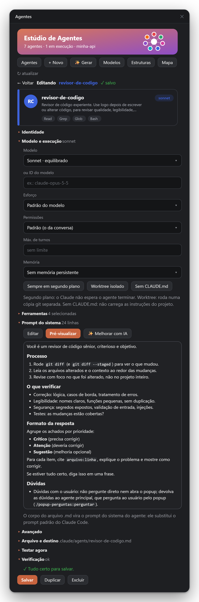</td>
    <td width="50%" valign="top"><b>Modelos prontos</b><br><br>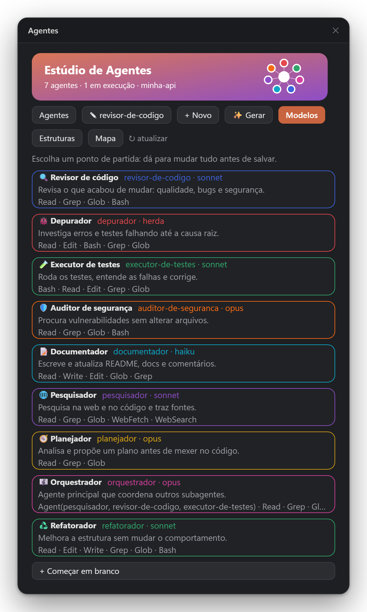</td>
  </tr>
  <tr>
    <td colspan="2" valign="top"><b>No terminal</b>: o mesmo painel, desenhado em texto.<br><br>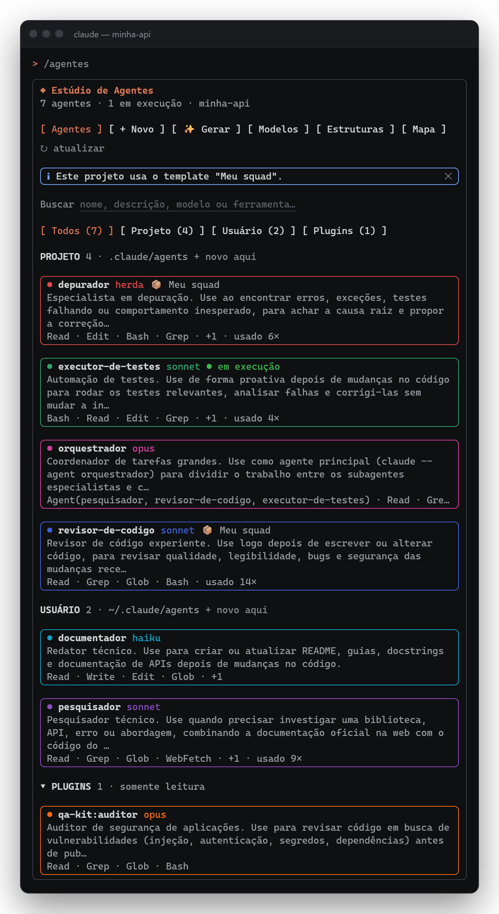</td>
  </tr>
</table>
</details>

<sub>As telas são geradas a partir da interface que o próprio painel desenha, com dados de exemplo; no
app, cores e botões seguem o tema do Claude Code.</sub>

## O que dá para fazer

- **Galeria** dos agentes do projeto (`.claude/agents`), do usuário (`~/.claude/agents`) e dos plugins
  instalados, em cartões com cor, modelo e ferramentas; busca e filtro por origem. Os cartões acendem
  **"em execução"** quando o Claude delega a um subagente e mostram quantas vezes cada um foi usado.
- **Editor visual**: nome, descrição, cor, modelo, esforço, modo de permissão, máximo de turnos,
  memória, segundo plano, worktree isolado; ferramentas por categoria (inclusive as de MCP da sessão),
  atalhos ("Somente leitura", "Desenvolvimento"…), ferramentas bloqueadas e os subagentes que um
  orquestrador pode chamar (`Agent(a, b)`).
- **Prompt do sistema** com pré-visualização em Markdown, estrutura sugerida e **✨ Melhorar com IA**
  (com desfazer).
- **Validação ao vivo** (nome repetido, descrição curta, campos inválidos…) e a prévia do arquivo `.md`
  que será gravado. Ao editar, só as linhas que você mudou mudam: `hooks`, `mcpServers` e outros
  campos que o editor não mostra são preservados.
- **Testar agora**: roda o rascunho como subagente desta sessão, sem salvar, e mostra a resposta.
- **Modelos prontos**: revisor de código, depurador, executor de testes, auditor de segurança,
  documentador, pesquisador, planejador, orquestrador e refatorador. Todos já saem com a regra de
  dúvidas: o orquestrador pergunta ao usuário pelo popup e os demais devolvem as dúvidas a ele.
- **✨ Gerar com IA**: descreva o agente em uma frase e o Claude escreve nome, descrição, ferramentas e
  prompt para você revisar. O prompt gerado também termina com a regra de dúvidas: o agente principal
  pergunta pelo popup e os subagentes devolvem as dúvidas a ele.
- **Estruturas de equipe**: dez equipes prontas, de desenvolvimento a pesquisa acadêmica, que você
  baixa para o projeto com o fluxo do agente principal no `CLAUDE.md`; dá também para salvar a sua
  própria, editá-la, clonar uma estrutura padrão e atualizar o template e o projeto nos dois
  sentidos. Veja [Estruturas de agentes](#estruturas-de-agentes).
- **Mapa de delegação**: quem é o agente principal e para quem ele pode delegar; dá para escolher o
  agente principal do projeto ali mesmo.
- **Lixeira**: agentes excluídos pelo estúdio ficam guardados e podem ser restaurados.

## Estruturas de agentes

Uma **estrutura** é uma equipe pronta para um tipo de trabalho. Ela tem duas partes: os agentes, em
`.claude/agents`, e o **fluxo do agente principal**, um trecho do `CLAUDE.md` que diz quando e como a
sessão principal divide o pedido entre a equipe. Os agentes conversam pela sala do **squad-stream**, e
cada parte entregue passa por um revisor antes de ser aprovada.

O **squad-stream** (a sala onde os agentes conversam) e o **popup-perguntas** já vêm como dependências
do estúdio, então você não precisa instalá-los à parte. Quando precisa de uma decisão, o agente
principal pergunta ao usuário pelo popup (`/popup-perguntas:perguntar`), e os subagentes perguntam ao
main na sala. Com o plano pronto, o main o mostra no popup dividido em partes, e você aprova, ajusta ou
tira cada parte; a equipe só trabalha nas partes aprovadas. Se a aba avisar que o squad-stream não está
instalado, veja *Problemas na instalação* em [Instalação](#instalação).

As dez estruturas e os papéis de cada uma (o último é sempre o revisor):

| Estrutura | Papéis |
|---|---|
| **Squad de desenvolvimento** | `gerador`, `artista-canva`, `modelador3d`, `revisor` |
| **Escritório jurídico** | `pesquisador-juridico`, `especialista-contratos`, `redator-de-pecas`, `compliance-lgpd`, `advogado-senior` |
| **Negócios** | `estrategista-marketing`, `copywriter`, `redator-de-propostas`, `analista-financeiro`, `analista-de-dados`, `revisor-de-negocios` |
| **IoT e firmware** | `engenheiro-firmware`, `engenheiro-hardware`, `especialista-protocolos`, `testador-embarcados`, `revisor-iot` |
| **Segurança de aplicações** | `auditor-appsec`, `analista-dependencias`, `modelador-de-ameacas`, `corretor-de-vulnerabilidades`, `revisor-seguranca` |
| **Suporte técnico** | `triagem-de-chamados`, `especialista-tecnico`, `redator-de-respostas`, `curador-base-conhecimento`, `revisor-atendimento` |
| **Estúdio de jogos** | `game-designer`, `programador-gameplay`, `artista-2d`, `modelador-3d`, `testador-qa`, `revisor-de-jogo` |
| **Conteúdo e mídia** | `roteirista`, `redator-seo`, `social-media`, `designer-de-pecas`, `editor-chefe` |
| **Educação** | `planejador-de-aulas`, `criador-de-exercicios`, `criador-de-materiais`, `revisor-pedagogico` |
| **Pesquisa acadêmica** | `pesquisador-de-literatura`, `metodologista`, `analista-estatistico`, `redator-academico`, `revisor-academico` |

Os nomes são os dos arquivos `<nome>.md` que a estrutura grava em `.claude/agents`.

- **Como baixar.** Em `/agentes estruturas`, abra a estrutura e escolha **Baixar e usar no projeto**. O
  estúdio grava os agentes em `.claude/agents/` e o fluxo no `CLAUDE.md`, entre os marcadores
  `<!-- agents-creator:estrutura:<id>:inicio -->` e `<!-- agents-creator:estrutura:<id>:fim -->`; o resto do
  `CLAUDE.md` não muda. Se já houver agente com o mesmo nome no projeto, o estúdio avisa e só substitui
  quando você marca **Sobrescrever** (os atuais vão para a lixeira). **Só salvar em Meus templates** guarda
  a estrutura sem mexer no projeto.
- **Como alternar.** Cada projeto tem um template ativo, mostrado no topo da aba. Ao baixar outro, o
  estúdio pede confirmação e troca: os agentes do anterior saem do projeto (vão para a lixeira do estúdio) e
  o trecho dele sai do `CLAUDE.md`. **Remover do projeto** faz o mesmo, sem colocar outro no lugar.
- **Meus templates.** Na segunda aba, **Salvar como template** guarda a equipe deste projeto (os agentes de
  `.claude/agents` e o fluxo do `CLAUDE.md`, se houver) para usar em outros projetos. Também dá para apagar
  um template da lista.
- **Onde fica.** Cada template da biblioteca é um arquivo em `~/.claude/agents-creator/estruturas/<id>.json`.
  O manifesto `.claude/agents-creator.json` diz qual template está ativo no projeto. Se a pasta
  `.claude/agents` for criada agora, reinicie a sessão, como descrito em
  [Onde os arquivos ficam](#onde-os-arquivos-ficam).
- **Plugins necessários.** No topo da aba, cada um dos 7 plugins mostra a versão instalada e se há
  versão nova. **Procurar atualizações** atualiza os catálogos dos marketplaces; **Atualizar** (ou
  **Atualizar todos**) roda `claude plugin update`, e **Instalar**, no plugin que falta, roda
  `claude plugin install`. Os que vêm de uma pasta local ficam como estão.
  Depois, rode `/reload-plugins`. Um plugin desligado aparece como desativado, com o botão **Ativar**
  (que roda `claude plugin enable`). O botão **Ver tudo o que eles precisam →** abre a tela Dependências.

### Seus templates

Um template que você salvou se edita. As cópias de estruturas padrão não se editam: para
personalizar uma, clone-a.

- **Editar.** No cartão de um template seu, clique em **✏️ Editar**. A tela mostra o nome, o
  resumo, o ícone e o fluxo do `CLAUDE.md`, com **Salvar**. Se o template estiver ativo no projeto,
  depois de salvar volte e use **Aplicar o template no projeto** para levar as mudanças para lá.
- **Agentes do template.** Cada agente tem **Editar**, que abre o editor do estúdio; nele, o botão
  de salvar vira **Salvar no template** e você volta ao template, sem mexer no projeto. Também dá
  para **Remover** um agente ou criar outro com **+ Novo agente**.
- **Clonar.** Para personalizar uma estrutura padrão, abra o detalhe dela e clique em **Clonar**. O
  nome sugerido é `<Título> (minha versão)`; ao clicar em **Criar e editar**, a cópia vai para
  **Meus templates** e abre no editor. Nos cartões das cópias do catálogo, o botão é
  **Clonar para editar**.
- **Atualizar o template com o projeto.** Se você mudou agentes ou o fluxo no projeto, este botão
  grava as mudanças no template ativo. Num template do catálogo, no lugar dele aparece
  **Salvar como template seu**, que leva a **Meus templates** com o nome `<Título> (minha versão)`
  preenchido.
- **Aplicar o template no projeto.** Leva o template ativo para `.claude/agents` e para o
  `CLAUDE.md`. O que for trocado vai para a lixeira do estúdio.
- **Versão nova.** Quando a estrutura padrão mudou, a cópia dela em **Meus templates** mostra
  **versão nova**. O botão **Atualizar** troca a cópia pela versão atual, sem mexer no projeto; se
  ela for a ativa no projeto, o aviso de mudanças oferece aplicar.
- **Detecção.** Se os agentes do projeto são os de um template de **Meus templates**, o estúdio
  marca esse template como ativo e registra isso no manifesto `.claude/agents-creator.json`; o mesmo
  acontece logo depois de **Salvar como template**. Quando o projeto muda em relação ao template
  ativo, um aviso no topo da aba lista os agentes alterados ou faltando e o fluxo do `CLAUDE.md`,
  com os botões **Atualizar o template com o projeto** e **Aplicar o template no projeto**.
- **Galeria.** Os agentes do projeto que vieram do template ativo ganham a etiqueta **📦**, com o
  nome do template.

## Dependências

O estúdio depende de 7 plugins, e cada um precisa de outras coisas para funcionar: skills avulsas,
extensão do VS Code, programas e o servidor do popup. O comando `/agentes-dependencias` mostra tudo
numa tela só e verifica se está instalado, rodando e atualizado.

Para abrir a tela:

- `/agentes-dependencias`: abre a tela e verifica tudo.
- `/agentes dependencias`: só abre a tela, sem verificar.
- O botão **Ver tudo o que eles precisam →**, no bloco **Plugins necessários** da aba Estruturas.

O que é verificado:

| Item | Quem precisa | Como o estúdio sabe |
|---|---|---|
| os 7 plugins | o estúdio | versão instalada contra a do catálogo; ligado ou não em `enabledPlugins` |
| plugins que os plugins declaram em `dependencies` | o plugin que declara | o plugin.json de cada plugin instalado (falta → Instalar) |
| skill squad-stream em `~/.claude/skills` | o painel /sala (squad-room-pane) | o `scripts/bus.js` existe e a cópia é igual à do plugin |
| skill review-edits em `~/.claude/skills` | o painel /revisao (diff-review-pane) | o `scripts/review.js` existe e a cópia é igual à do plugin |
| extensões do VS Code (Claude Request History, Claude Review, Squad Room, Claude Popup de Perguntas, Estúdio de Agentes) | historico, diff-review, squad-stream, popup-perguntas e o estúdio | a lista de extensões do VS Code contra a versão do `.vsix` do repositório |
| Node.js 18+, git, comando code | scripts e hooks dos plugins, o historico, a instalação das extensões | `--version` de cada um |
| servidor do popup | a ferramenta perguntar | `claude mcp list` |

Os símbolos na tela:

- ✓ em dia;
- ↑ versão nova;
- ✗ falta;
- ⏸ desativado;
- ■ parado (o servidor não conectou);
- – opcional (por exemplo, extensão sem o VS Code instalado);
- ● pasta local;
- ? não deu para saber.

Os botões:

- **Verificar tudo** atualiza os catálogos e testa os programas e o servidor do popup.
- **Corrigir tudo** instala, atualiza e ativa os plugins, copia as skills e instala as extensões do VS Code. Não instala programas.
- Cada linha com pendência tem o seu botão: **Instalar**, **Atualizar**, **Ativar** ou **Copiar**. A exceção é o servidor do popup: a tela só confere se ele conectou, e a linha diz o que fazer.
- Um programa que falta tem o botão **Instalar**, que usa o winget no Windows e o brew no macOS. O winget aceita os termos do pacote sozinho. Depois, feche e abra o Claude Code.
- Quando um comando não roda ali, a tela mostra no fim o comando pronto para o terminal.

Depois de corrigir:

- plugins: rode `/reload-plugins`;
- extensões: no VS Code, **Developer: Reload Window**;
- programas: feche e abra o Claude Code.

Se nem o `/agentes` aparece, o estúdio não carregou porque falta uma dependência. Nesse caso, rode o instalador do marketplace, que fica em `~/.claude/plugins/marketplaces/agents-creator/install.js`. Antes, rode com `--verificar` para ver o que falta:

```bash
node "$HOME/.claude/plugins/marketplaces/agents-creator/install.js" --verificar
```

Se ele responder "opção desconhecida", o marketplace ainda está numa versão anterior à 0.4.0. Atualize-o e rode de novo:

```bash
claude plugin marketplace update agents-creator
```

## Como usar

Digite `/agentes` para abrir o painel. Atalhos:

| Comando | Abre |
|---|---|
| `/agentes` | a galeria (ou a tela em que você parou) |
| `/agentes novo` | o editor com um agente em branco |
| `/agentes gerar um revisor de PRs focado em segurança` | a geração com IA, já gerando |
| `/agentes modelos` | os modelos prontos |
| `/agentes mapa` | o mapa de delegação |
| `/agentes estruturas` | as estruturas de equipe (templates) |
| `/agentes-dependencias` | a tela Dependências e verifica tudo (plugins, skills, extensões do VS Code, programas e o servidor do popup) |
| `/agentes dependencias` | só a tela Dependências, sem verificar |
| `/agentes revisor-de-codigo` | esse agente no editor |

Também dá para pedir em linguagem natural — *"cria um agente que revisa migrações de banco"* — e o
Claude abre o estúdio com um rascunho preenchido (ferramenta `open_agents_studio`, ensinada pela skill
`criar-agentes`). Nada é gravado até você clicar em **Criar agente**.

### No VS Code

Não há nada a mais para instalar: a extensão do Claude Code no VS Code usa a mesma configuração do
terminal e do app desktop (`~/.claude`). Com o plugin instalado no escopo de usuário, abra o painel
do Claude no VS Code e digite `/agentes`: o estúdio abre ali mesmo, no painel.

- A extensão do Claude Code precisa ser recente, com suporte a painéis de plugin (a mesma exigência
  do terminal). Atualize pela aba Extensões do VS Code.
- Se o VS Code já estava aberto durante a instalação, abra uma conversa nova no painel do Claude.
- Se você apontou o Claude do VS Code para outra pasta de configuração (`CLAUDE_CONFIG_DIR` em
  `claudeCode.environmentVariables`), instale o plugin também nessa configuração.

#### Extensão Estúdio de Agentes (ícone próprio na barra lateral)

Para abrir o estúdio sem passar pelo chat, instale a extensão que está em `dist/`. O instalador (`node install.js`) e a tela Dependências também instalam essa extensão. Para instalar à mão:

```bash
code --install-extension dist/estudio-de-agentes-0.1.0.vsix
```

Depois, `Ctrl+Shift+P` → **Developer: Reload Window**. O ícone **Estúdio de Agentes** aparece na barra de
atividades e abre as mesmas telas do `/agentes` (Galeria, Editor, Modelos, Estruturas, Mapa e Lixeira), que
se atualizam sozinhas quando os arquivos dos agentes mudam. Os botões do topo criam um agente, abrem o
estúdio numa aba do editor, abrem `/agentes` no Claude Code e atualizam a lista.

- A extensão roda o próprio código do painel, sem conversa aberta. **Gerar**, **Melhorar com IA** e
  **Testar agora** abrem o Claude Code com o pedido já digitado: confira e aperte Enter lá.
- O código fica em `extensions/estudio-de-agentes`. Para gerar o `.vsix` de novo: `npm install`,
  `npm test` e `node scripts/empacotar.mjs` nessa pasta.

### Onde os arquivos ficam

- **Projeto**: `.claude/agents/<nome>.md` — vai para o git e vale para quem usar o repositório; tem
  prioridade sobre o do usuário quando os nomes coincidem.
- **Usuário**: `~/.claude/agents/<nome>.md` — vale para todos os seus projetos.
- **Plugins**: somente leitura; use **Salvar cópia** para personalizar.

O Claude Code recarrega as pastas de agentes sozinho. A exceção é a primeira vez que a pasta
`.claude/agents` é criada durante uma sessão: aí é preciso reiniciar a sessão (o estúdio avisa), ou
usar **Testar agora** enquanto isso.

O **agente principal** (escolhido no mapa ou no editor) é gravado como `"agent"` em
`.claude/settings.local.json`, que vale só para você e não entra no git. Para uma sessão só, use
`claude --agent <nome>`.

## Desenvolvimento

```
install.js                      instala ou atualiza o estúdio, os 7 plugins e o que eles precisam
INSTALL.md                      instruções para o Claude instalar o estúdio
.claude-plugin/plugin.json      manifesto, ícone (icon.png) e marketplace.json
hooks/hooks.json                aponta para o módulo de hooks
hooks/register.tsx              comando /agentes, ferramenta, eventos de subagentes e o painel
hooks/actions.ts                estado da sessão e o que cada botão faz
hooks/estruturas.ts             aba Estruturas: baixar, alternar, salvar e apagar templates de equipe
hooks/requisitos.ts             tela Dependências: verifica e corrige o que os plugins precisam
hooks/lib/                      formato dos arquivos (YAML), varredura, IA, catálogo, SVGs, modelos
hooks/lib/dependencias.ts       os 7 plugins e a leitura das versões instaladas
hooks/lib/requisitos.ts         funções puras dos requisitos: skills, extensões, programas e o servidor do popup
hooks/lib/estruturas/           catálogo das 10 equipes e o protocolo da sala do squad-stream
hooks/lib/perguntas.ts          regra de dúvidas pelo popup (popup-perguntas)
hooks/ui/                       telas: galeria, editor, modelos, estruturas, geração, mapa e lixeira
hooks/ui/dependencias.tsx       tela Dependências (/agentes-dependencias)
skills/criar-agentes/SKILL.md   ensina o Claude a abrir o estúdio com um rascunho
types/index.d.ts                contrato dos valores de estado
tests/                          testes (formato dos arquivos e o painel em todas as superfícies)
docs/                           logo, ícone (SVG) e as telas do README
scripts/telas/                  gera de novo as telas do README e o ícone em PNG
scripts/testar-install.mjs      testes do instalador (install.js), rodados com node --test
```

```bash
claude plugin validate .
```

```bash
claude plugin test .
```

Os testes do instalador (`install.js`) rodam com:

```bash
node --test scripts/testar-install.mjs
```

Depois que o Claude Code carrega o plugin de uma pasta que ele vigia, os tipos da API ficam em
`.claude-plugin/types/` e `tsc -p .` faz a checagem de tipos.

### Telas do README e ícone

As imagens de `docs/prints/` e o `.claude-plugin/icon.png` saem do próprio código do painel: um cenário
com agentes de exemplo desenha cada tela pelo kit de testes do Claude Code, o resultado vira HTML e o
Chrome (ou Edge) em modo headless tira o print. Depois de mudar a interface, gere tudo de novo com:

```bash
node scripts/telas/gerar-telas.mjs
```

Precisa de Node 18+, do Claude Code (`claude` no PATH) e do Chrome ou Edge; se o navegador não for
encontrado, informe o caminho em `CHROME_PATH`. O ícone é renderizado a partir de `docs/icon.svg`.

A API de *function hooks* está em acesso antecipado e pode mudar entre versões do Claude Code.

## Licença

MIT — veja [LICENSE](LICENSE).
